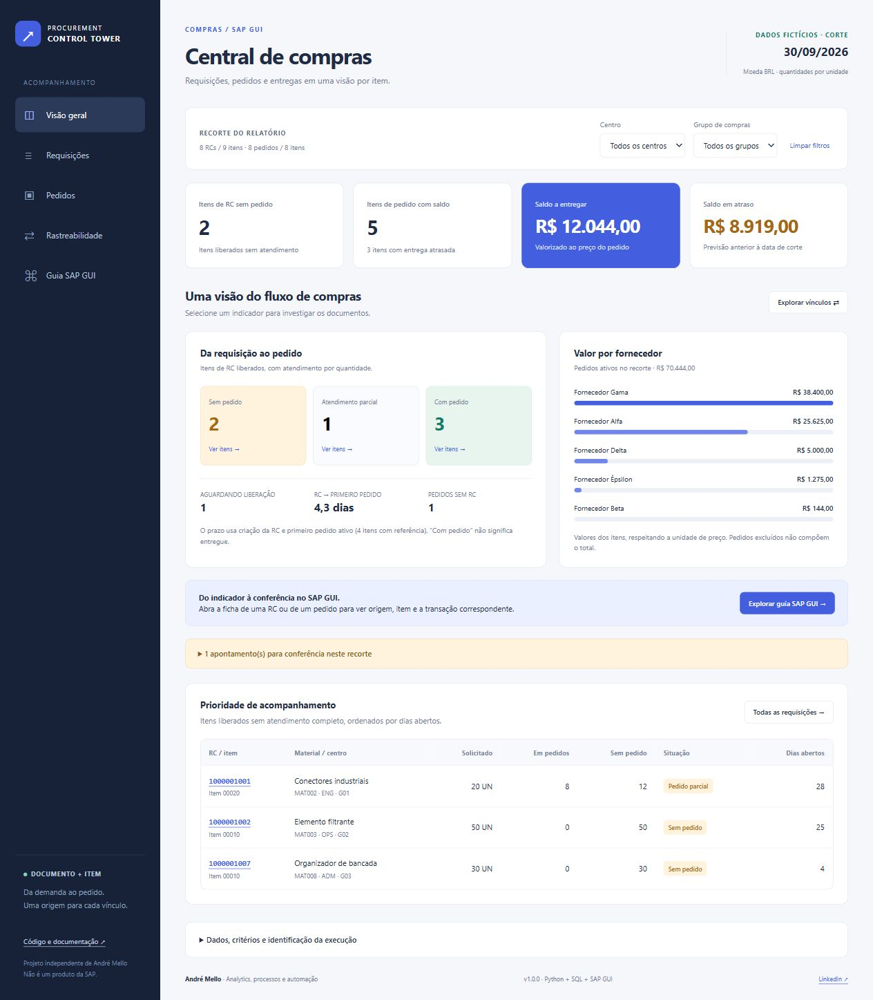

# SAP Procurement Control Tower

**Da requisição ao pedido: controle de compras por documento e item, com rastreabilidade e SQL reproduzível.**

Painel para acompanhar requisições de compra, pedidos, saldos a entregar e previsões vencidas. Permite explorar indicadores consolidados, consultar os vínculos entre documentos e identificar os registros de origem, com roteiros de conferência no SAP GUI.

Desenvolvido em **Python, SQL, HTML, CSS e JavaScript**, gera relatórios que podem ser consultados no navegador, inclusive offline.


[Demonstração online](https://andremellotech.github.io/sap-procurement-control-tower/) · [Guia de uso](docs/user-guide.md) · [Guia SAP GUI](docs/sap-gui-guide.md) · [Contrato de dados](docs/data-contract.md) · [Publicação](docs/publish-guide.md)

> **Em desenvolvimento:** projeto de portfólio de [André Mello](https://github.com/andremellotech), com dados inteiramente fictícios, materiais e fornecedores genéricos. Implementação independente, sem conexão ativa com o SAP e sem vínculo oficial com a SAP.



## Visão geral

O SAP Procurement Control Tower organiza informações de requisições e pedidos de compra para facilitar a identificação de pendências e a conferência dos documentos.

A solução processa arquivos exportados e normalizados, aplica regras analíticas em SQL e gera uma interface com indicadores, filtros, detalhamento e rastreabilidade.

Os roteiros SAP GUI apoiam a consulta dos documentos no sistema. Eles utilizam quadros didáticos próprios e referências à documentação oficial, sem capturas corporativas.

## Principais recursos

- **Visão consolidada:** pendências de requisições, saldos a entregar, atrasos e fornecedores.
- **Análise por item:** detalhamento de quantidades, previsões e situação dos documentos.
- **Atendimento das requisições:** identificação de itens sem pedido ou parcialmente atendidos.
- **Rastreabilidade:** vínculos entre uma requisição e seus pedidos, sem duplicar a quantidade solicitada.
- **Origem dos registros:** referência ao arquivo e à linha de entrada.
- **Conferência no SAP GUI:** roteiros ligados às fichas dos documentos.
- **Exportação:** geração de CSV da lista filtrada.
- **Uso offline:** consulta do relatório local no navegador.

## Tecnologias utilizadas

| Tecnologia | Papel no projeto |
|---|---|
| **Python 3.11+** | Leitura, validação e transformação das bases, além da geração dos relatórios |
| **SQL e SQLite** | Estruturação dos dados e execução das regras analíticas |
| **HTML e CSS** | Estrutura e apresentação da interface |
| **JavaScript** | Filtros, navegação e interações do relatório |
| **Node.js** | Verificações de sintaxe e testes JavaScript |
| **GitHub Actions** | Fluxos de validação configurados para Windows e Ubuntu |
| **GitHub Pages** | Publicação da demonstração estática, quando habilitado |

A interface não depende de CDN ou serviços externos. As dependências Python estão declaradas em `requirements.txt`.

## Perguntas que o painel ajuda a responder

- Quais itens de requisição liberados continuam sem pedido?
- Quais requisições possuem atendimento parcial?
- Quais itens de pedido têm saldo a entregar e previsão vencida?
- Como uma requisição se distribui entre vários pedidos?
- Existem quantidades em pedidos ativos superiores à quantidade requisitada?
- De qual arquivo e linha veio cada registro?
- Em qual transação SAP GUI o documento pode ser conferido?

## Cinco perspectivas integradas

| Perspectiva | Conteúdo |
|---|---|
| **Visão geral** | Itens sem pedido, saldos a entregar, atrasos, fornecedores e prioridades |
| **Requisições** | Quantidade solicitada, quantidade em pedidos ativos, saldo e situação |
| **Pedidos** | Fornecedor, requisição de origem, previsão, quantidades e saldo valorizado |
| **Rastreabilidade** | Vínculos entre requisição/item e pedidos/itens, com identificação da origem |
| **Guia SAP GUI** | Roteiros ME53N, ME5A, ME23N e ME2N ligados às fichas |

### Filtros e recortes

Centro e grupo de compras definem o recorte dos indicadores. Os filtros de busca e situação atuam sobre a lista e o CSV correspondente.

O cálculo de atendimento da requisição e a rastreabilidade consideram **todos os vínculos disponíveis no snapshot**, inclusive quando um pedido pertence a outro grupo de compras.

### Conferência dos documentos

Na ficha de um pedido, a opção **Ver roteiro ME23N** direciona ao guia correspondente e preserva o número do documento e do item.

A rastreabilidade apresenta todos os pedidos vinculados ao item da requisição, inclusive os excluídos. A participação desses registros nos cálculos segue as regras dos indicadores.

## Conceitos e regras de interpretação

| Conceito | Significado no projeto |
|---|---|
| **RC** | Requisição de compra |
| **Pedido ativo** | Pedido considerado ativo conforme os estados normalizados no contrato de dados |
| **Atendimento da RC** | Comparação entre a quantidade solicitada e a quantidade vinculada a pedidos ativos |
| **Saldo a entregar** | Quantidade pendente de entrega conforme os dados e as regras do modelo |
| **Previsão vencida** | Previsão anterior à data de corte para um item com saldo a entregar |
| **Saldo valorizado** | Estimativa operacional calculada com base no saldo e no preço informado |
| **Snapshot** | Conjunto de dados utilizado em uma execução, associado a uma data de corte declarada |

**Atendimento da requisição por pedido não equivale a recebimento do material.** São etapas distintas do processo de compras.

O saldo valorizado considera o preço e sua unidade de referência, sem incluir tributos ou frete. Ele não representa custo realizado nem compromisso contábil.

Consulte as [regras dos indicadores](docs/metrics.md).

## Dados da demonstração

A demonstração utiliza exclusivamente **dados fictícios**, preparados para explorar situações como:

- Requisições sem pedido.
- Atendimento parcial ou integral por pedidos.
- Uma requisição vinculada a vários pedidos.
- Pedidos excluídos.
- Compras sem referência a requisição.
- Recebimentos parciais.
- Preços informados por múltiplas unidades.
- Quantidades em pedidos ativos superiores à quantidade requisitada.

Os cenários ilustram o funcionamento das regras e não representam operações reais, fornecedores ou empresas.

## Como executar

### Abrir a demonstração

Para uso offline, extraia o projeto completo e abra:

```text
index.html
```

Para acesso pela web, utilize a [demonstração online](https://andremellotech.github.io/sap-procurement-control-tower/), quando o GitHub Pages estiver habilitado.

### Requisitos

- **Python 3.11 ou superior** para gerar os relatórios.
- Dependências declaradas em `requirements.txt`.
- **Node.js** para executar as verificações JavaScript.

### Instalar as dependências

Na pasta do projeto, execute:

```bash
python -m pip install -r requirements.txt
```

### Gerar um relatório com as bases de exemplo

```bash
python -m procurement build --input sample-input --mapping config/mapping.json --as-of 2026-09-30 --output local-output/primeira-execucao
```

O parâmetro `--as-of` define a data de corte da análise. No comando acima, a data corresponde ao cenário fictício de demonstração.

Após a execução, abra:

```text
local-output/primeira-execucao/index.html
```

O processo valida os arquivos e gera:

- Relatório HTML autocontido.
- Arquivos JSON.
- Arquivos CSV.
- Banco SQLite com tabelas e consultas.

Utilize uma pasta de saída vazia e separada da entrada. Os arquivos recebidos não são modificados.

### Interpretar o resultado da execução

| Código de retorno | Significado |
|---|---|
| **0** | Relatório gerado, inclusive quando existem alertas de conferência |
| **1** | Erro na execução |

A geração do relatório não representa aprovação do processo de compras. Os alertas devem ser avaliados conforme o contexto e as evidências disponíveis.

### Recriar a demonstração pública

```bash
python -m procurement demo
```

Esse comando atualiza somente os arquivos demonstrativos conhecidos em `reports/demo` e o `index.html` principal.

Para trabalhar com dados próprios, utilize `build` com uma pasta de saída separada.

## Adaptar para dados próprios

O projeto aceita:

- **CSV em UTF-8**.
- **XLSX contendo valores**, conforme o contrato de entrada.
- Mapeamento explícito de colunas e formatos.

Para preparar as bases:

1. Consulte o contrato de dados.
2. Preserve os zeros à esquerda dos números de documento.
3. Mantenha as unidades de medida e de preço.
4. Configure o mapeamento das colunas e dos formatos.
5. Informe a data de corte correspondente à análise.
6. Gere o relatório em uma pasta separada.
7. Confira os alertas, vínculos e indicadores.

Os campos e estados utilizados são uma normalização própria do projeto e não representam um layout universal SAP.

**Mantenha bases e relatórios com dados reais fora do repositório público.**

Consulte o [guia de uso](docs/user-guide.md) e o [contrato de dados](docs/data-contract.md).

## Estrutura do projeto

```text
procurement/       Leitura, validação, motor SQL e geração do relatório
sql/               Tabelas e views SQL comentadas, efetivamente executadas
sample-input/      Duas extrações fictícias em CSV
config/            Mapeamento de colunas, formatos e guia SAP GUI
reports/demo/      Resultados processados, CSVs, JSON e SQLite
web/               Interface HTML, CSS e JavaScript
docs/              Guias de uso, indicadores, extração e publicação
tests/             Regras, leitura, exportação e recortes visuais
.github/workflows/ Validação configurada para Windows e Ubuntu
index.html         Demonstração pronta para abrir ou publicar
```

## Integração com Power BI

O projeto inclui um [roteiro para levar os dados ao Power BI](docs/powerbi-guide.md).

**Nenhum arquivo `.pbix` nativo está incluído nesta versão.**

## Verificações

Com Python, as dependências e Node.js disponíveis, execute:

```bash
python -m unittest discover -s tests
node --check web/app.js
node --check web/metrics.js
node tests/test_metrics.cjs
```

A matriz de integração contínua está configurada para:

- **Sistemas:** Windows e Ubuntu.
- **Python:** 3.11, 3.12 e 3.13.

Os resultados remotos dependem do envio e da execução do workflow no GitHub.

Consulte o [registro de verificação](docs/verification.md).

## Escopo e limitações

O modelo atual cobre materiais com:

- Um centro por item.
- Uma unidade de medida por item.
- Uma previsão de entrega por item.
- Valores em BRL.

Os seguintes cenários exigem extensão do modelo:

- Serviços.
- Rateio múltiplo.
- Remessas de entrega.
- Moedas diferentes.
- Histórico de recebimentos e faturas.

A data de corte é declarada. Sem histórico de eventos, o modelo não reconstrói posições passadas nem calcula o desempenho histórico de entrega no prazo.

Os roteiros SAP GUI são materiais de apoio: não abrem nem alteram transações no sistema.

## Possíveis evoluções

As possibilidades abaixo ainda não estão implementadas:

- Histórico de eventos.
- Detalhamento de remessas de entrega.
- Integração de informações de recebimento e fatura.
- Perfis adicionais de exportação.
- Arquivo Power BI homologado.

## Contribuições

Sugestões e relatos de problemas podem ajudar na evolução do projeto.

Ao compartilhar exemplos, utilize dados fictícios e descreva o comportamento observado e o resultado esperado.

Consulte as [orientações para contribuir](CONTRIBUTING.md).

## Autoria e licença

Desenvolvido por **André Mello**.

[GitHub](https://github.com/andremellotech) · [LinkedIn](https://www.linkedin.com/in/aamello/)

Código e exemplos fictícios disponibilizados sob a [licença MIT](LICENSE).
